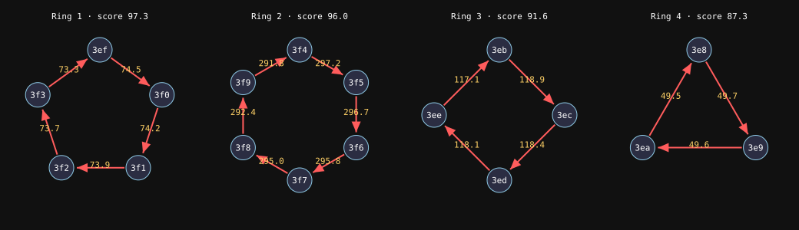

# Crypto Cyclic Transaction Fraud Detection — Demo

Detects **wash trading / round-tripping**: crypto sent around a loop of wallets
(`A → B → C → D → A`) to fake volume or launder funds.

```bash
python3 cycle_fraud_detector.py   # pure stdlib, no installs
```

## Pipeline

```
 transactions ──► directed graph ──► temporal cycle search ──► risk score ──► fraud rings
 (src,dst,amt,ts)  wallets = nodes    each hop later than last   0..100       + SVG picture
                   txs = edges        all within 3-day window
```

## Risk score (0–100)

| Signal              | Max pts | Why it's sus                                   |
|---------------------|---------|------------------------------------------------|
| Amount preservation | 40      | same money keeps going round (only fees lost)  |
| Speed               | 30      | loop closes in minutes, not days               |
| Loop length         | 15      | more hops = deliberate layering                |
| Burner wallets      | 15      | low-activity / fresh addresses                 |

Cycles scoring ≥ 70 get flagged. Flagged cycles that share wallets are merged into rings.

## Output

Prints each ring with a reason for the flag, lists low-score legit loops (including a
planted "friends splitting rent" decoy), shows precision and recall against the planted
ground truth, and writes `fraud_rings.svg`.



## Next steps for real data
- Load real txs (Etherscan / BigQuery `crypto_ethereum.transactions`) into `Transaction`.
- Handle token swaps and DEX hops (value changes asset mid-loop).
- Swap the hand-tuned score for an ML model (GNN or gradient boosting) trained on these cycle features.
